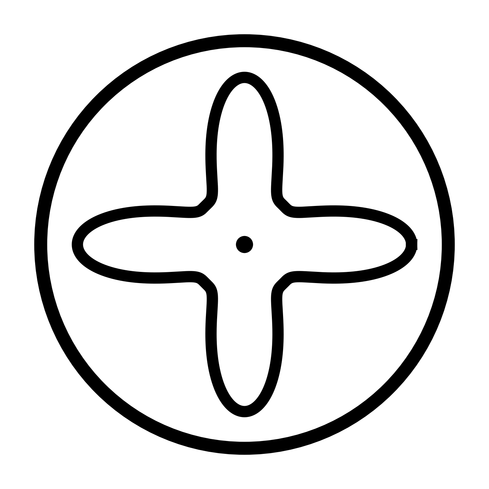

<h1 align="center">Chladni aka Chutney</h1>

<p align="center">
  <em>Chladni or as I like to call it Chutney, is a Python based visual generated named after Ernst Chladni. Live code visuals that react in real time to audio and gestures.</em>
</p>

---

<p align="center">
  <picture>
    <source media="(prefers-color-scheme: dark)" srcset="logo/chladni_logo.svg">
    
  </picture>
  <br>
  <sub>Logo generated via <a href="logo/make.py"><code>logo/make.py</code></a></sub>
</p>

---

Chutney draws a lot of inspiration from [TouchDesigner](https://derivative.ca/) and [Hydra](https://hydra.ojack.xyz/), trying to make something that natively uses Python so it can be easily modified and extended locally. I chose a local Python environment rather than the browser because I feel that audio routing is much easier to handle, and the application runs much faster when integrating local ML models for more interesting experiments. It is heavily inspired by the node-based structure of TD, allowing workflows to be defined like a DAG (shoutout to [Airflow](https://airflow.apache.org/)) and modified in real time.

If something looks like slop and reads like slop, it is slop my brother.

## Quickstart


### Prerequisites

Install [pixi](https://pixi.sh) (recommended) or use a Python 3.11+ environment with ModernGL and MediaPipe installed.

```bash
# Clone the repository
git clone https://github.com/sangarshanan/chladni.git
cd chladni

# Install dependencies
pixi install
```

### Running Examples

```bash
# Run audio-reactive particles and reactive geometries
pixi run circle_particle

# Run gesture + audio-driven ISF shader over camera feed
pixi run isf
```

You can also run any patch directly with the hot-reloading runner:

```bash
python -m src.runner examples/shader.py
```

---

## Architecture

Visuals in `chladni` are assembled inside a reactive `Pipeline` block, where inputs, generators, and geometries connect via live `Signal` streams and are routed to `Output` using the `>>` operator.

```python
from src import Pipeline, AudioBands, GestureInput, ISFGenerator, Output

with Pipeline() as pipeline:
    # Inputs
    audio = AudioBands()
    gesture = GestureInput()

    # ISF Shader driven by audio and hand gestures
    warp = ISFGenerator("shaders/color_diffusion_flow.fs")
    warp.rate1 = audio.mid.map(0.8, 2.5)          # Melody drives flow rate
    warp.color1 = gesture.fingers.map(-2.0, 2.0)   # Fingers shift colour phase
    warp.alpha = gesture.pinch.map(0.1, 0.85)     # Pinch controls shader blend

    # Post-processing & Output
    output = Output(
        background=(0.0, 0.0, 0.0),
        tonemap="aces",
        bloom=1.0,
        bloom_threshold=0.8,
        render_scale=1.5,
    )

    # Route layers into output (bottom to top)
    gesture.overlay >> output
    warp >> output
```

## License

This project is released into the public domain under [The Unlicense](LICENSE).
